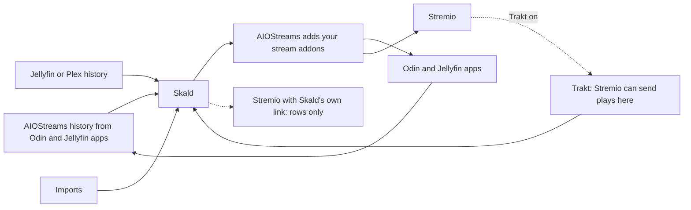

# Skald

Skald runs one container per household and serves personal rows and search as a Stremio addon. It learns from plays, ratings and imports. It does not play anything; your stream addons do.

## How it fits



## Pick your setup

| You watch in | Connect with | Skald learns from | Tested |
|---|---|---|---|
| Odin / Jellyfin apps | AIOStreams Jellyfin mode | AIOStreams database connector | Yes, Odin on Apple TV |
| Stremio via AIOStreams | Stremio link from `skald setup aiostreams` | Trakt or imports | Yes, self-hosted 2.35.9 on the same machine |
| Stremio with Skald's link | Printed member or Together link, rows only | Trakt or imports | No |
| Plex | Keep playback; import history | Plex history connector or imports | No |
| ElfHosted AIOStreams | Add Skald's HTTPS manifest URL | Trakt or imports | No |

Stremio viewing reaches Skald only through Trakt.
Stremio keeps viewing in your account, which addons cannot read. AIOStreams records no Stremio playback.
The tested Stremio path shows all rows, title pages and AI search. Mixed rows show as “TV channel”.

## Quickstart

Use Docker and Docker Compose on your data machine. Get a free [TMDB API key](https://www.themoviedb.org/settings/api).

```sh
git clone https://github.com/Sophanos/skald skald && cd skald
mkdir -p data && sudo chown 65534 data && sudo chmod 700 data
cp .env.example .env && cp .env.aiostreams.example .env.aiostreams && chmod 600 .env .env.aiostreams
${EDITOR:-vi} .env .env.aiostreams
```

Put `TMDB_API=YOUR_KEY` and optional `OPENROUTER_API_KEY=YOUR_KEY` in `.env`.
Delete the `SKALD_MEMBERS`, `SKALD_LANG` and `SKALD_TZ` lines from `.env`.
Setup asks for names, language and timezone. Skald runs as user 65534 and keeps DATA private.
Make the AIOStreams secret with `openssl rand -hex 32`; set it and the public HTTPS address in `.env.aiostreams`.

```sh
docker compose -f compose.stack.example.yaml up -d --build
docker compose -f compose.stack.example.yaml exec skald skald setup
docker compose -f compose.stack.example.yaml exec skald skald setup aiostreams
```

The empty Skald container waits for setup. Follow the printed next steps. Setup makes your AIOStreams login with Skald and TMDB title details.
Add the printed server in Odin and use the printed user and password, or install the printed Stremio link.
Configure your stream addons in AIOStreams. Connect `aiostreams-db` below to learn from Odin viewing.
[AIOStreams](https://github.com/Viren070/AIOStreams) is a separate project with its own docs and licence. We use its published image.

AIOStreams by hand instead:

- Add Skald as a custom addon with the printed internal URL.
- Add The Movie Database addon with only Meta/details on, so title pages show.
- The TMDB key under Services → Metadata does not fill title pages.

Stremio only, without AIOStreams: copy only `.env`, edit it as above, then run `docker compose up -d --build`.
Run `docker compose exec engine skald setup --watch stremio` and install the printed link.

## Reach it from outside

Only AIOStreams needs an HTTPS address for apps outside your home network. Set up your own reverse proxy or tunnel. Skald stays inside the Docker network.

## Teach it your taste

Imports run on a laptop with Python 3.12 and a clone of this repo. First [make the laptop API reachable](docs/SETUP.md#6-link-a-laptop-optional).

1. On the server: `docker compose -f compose.stack.example.yaml exec skald skald setup link --name laptop`. This token covers every member. Adding `--person alex` limits it to Alex; other members' titles are skipped when pushing.
2. On the laptop: `python3 -m skald connect http://127.0.0.1:8081 --token-stdin`. Use your own API address and paste the token.
3. Preview: `python3 -m skald import imdb ratings.csv --person NAME --remote --dry-run`. Your server resolves titles; the laptop needs no TMDB key. To save, repeat without `--dry-run` and with `--yes`. Without server lookups, use `--resolve-online` with `TMDB_API` on the laptop.
4. `python3 -m skald push imports --remote` previews the send. Add `--apply` to send.

For the connector commands below, use the server prefix `docker compose -f compose.stack.example.yaml exec skald`.

| Source | Import kind and file |
|---|---|
| Netflix viewing CSV, with profile mapping | `netflix ViewingActivity.csv` |
| IMDb ratings or watchlist CSV | `imdb ratings.csv` |
| Letterboxd export with ratings, diary, watched and likes | `letterboxd export-folder` |
| Trakt JSON export | `trakt export-folder` |
| YouTube Takeout history | `youtube watch-history.json` or `youtube watch-history.html` |
| Chrome history database copy | `chrome History` |
| Plain text, one title per line | `plain titles.txt` |
| Trakt API | `skald setup --connect trakt` |
| Jellyfin server history | `skald setup --connect jellyfin` |
| Plex history | `skald setup --connect plex` |
| AIOStreams database: watched state, progress, favourites and ratings from Jellyfin apps | `skald setup --connect aiostreams-db` |

For Stremio, turn on Trakt in Stremio settings and connect Trakt here. A Trakt API app may need VIP; JSON imports need no API app.
Clicks and opened title pages are not recorded. Skald learns from plays, ratings and imports.
After imports or new connector data, rows update on the next eligible build: a background loop pauses 60 seconds between passes, most taste based rows have a 30 to 60 minute rebuild limit, and some follow longer schedules.

## Search

Title search works without OpenRouter. With it, ask for “cozy mystery for a rainy evening” and get AI picks, mood shelves and weekly picks.

## Privacy

Household history and taste stay on your machine. TMDB receives title lookups. Optional OpenRouter receives taste and history context. AniList receives anime titles, possibly from your history. Optional NZBHydra receives titles for availability checks. Configured connectors receive history requests.
Keep addon links, tokens, data and backups private. Anyone with the household addon link can choose any member's rows.

## Status

One household per container, one to six members. Live services and Docker are separate from offline tests. Check progress with `docker compose -f compose.stack.example.yaml exec skald skald setup --status`.
See [setup](docs/SETUP.md), [watching](docs/WATCH.md), [connectors](docs/CONNECTORS.md), [backups and upgrades](docs/UPGRADE.md), and [commands](docs/CLI.md).

## License

[GNU AGPL-3.0](LICENSE). This product uses TMDB and the TMDB APIs but is not endorsed, certified, or otherwise approved by TMDB.
