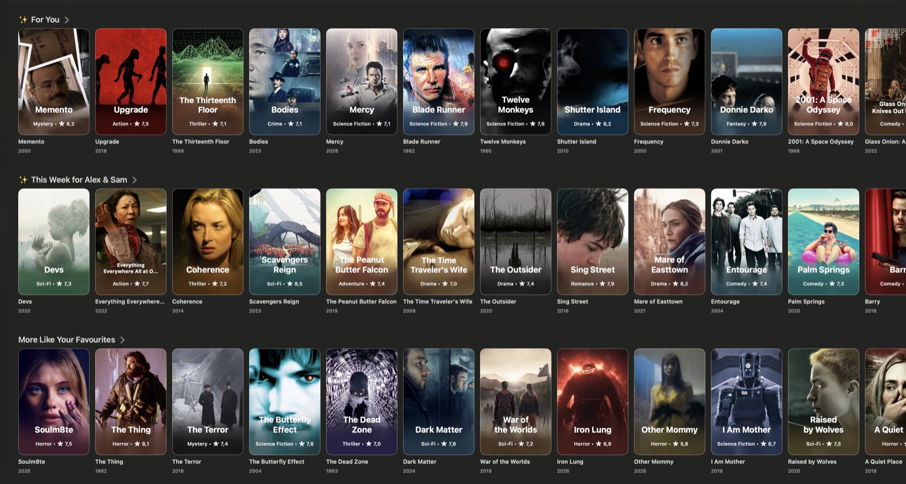
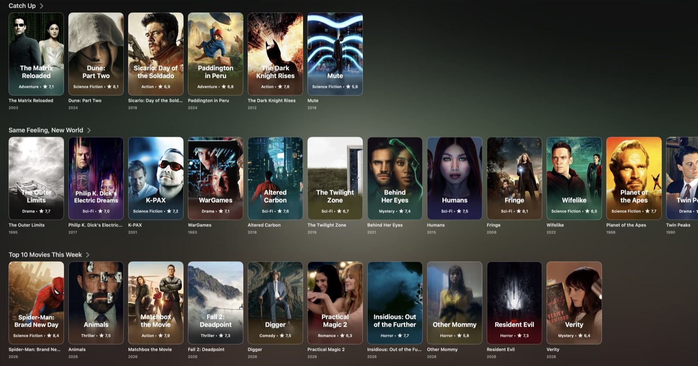
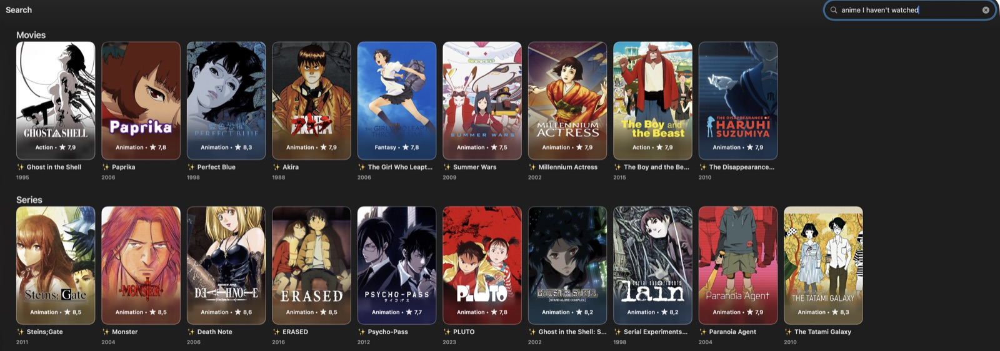

# Skald

<p align="center">
  <a href="https://github.com/Sophanos/skald/releases"></a>
  <a href="LICENSE"></a>
  <a href="https://github.com/Sophanos/skald/actions/workflows/ci.yml"></a>
</p>

**Skald learns what each person in your home likes and fills your TV with rows picked for them.**

Up to six people get their own rows, plus Together rows for watching as a group.
You steer it from the search box on your TV: ask for a mood, ask why a title showed up, or tell it who really watched.

Self-hosted in one container. Works in Odin (Apple TV and Mac), Stremio and Jellyfin apps through AIOStreams; your stream addons still play the video.



## Install

### 1. Pick your setup

| You watch in | Install with | Learns from |
|---|---|---|
| Odin on Apple TV or Mac, Jellyfin apps | AIOStreams in Jellyfin mode | AIOStreams database, accounts, imports |
| Stremio via AIOStreams | Stremio link from `skald setup aiostreams` | Stremio library, accounts, imports |
| Stremio with Skald's link | Printed member or Together link | Stremio library, accounts, imports |

Tested by us: Odin on Apple TV and self-hosted Stremio via AIOStreams. Not tested with live services: Stremio-direct playback, Plex and the standalone Jellyfin connector (the Stremio library connector has synthetic tests).
Ready-to-run [Compose setups](examples/README.md) cover LAN apps, existing AIOStreams, HTTPS, a tunnel or a small box. See [watching](docs/WATCH.md).

### 2. Connect AI (optional)

Without AI, home rows, title search and short commands such as "hide anime" work. An [OpenRouter](https://openrouter.ai) key adds:

- **Search that understands requests**, like "anime I haven't watched" or "cozy mystery for a rainy evening", checked against your history.
- **Picks:** ✨ For You and ✨ This Week, plus tonight's mood shelves.
- **Experience tags** on titles, which fill `Picks for <member>`, `Same Feeling as <title>`, mood shelves and Fresh Finds.
- **Free wording** for commands and wish shelves, and sorting of unclear import matches.

Cost is capped: AI calls stop at 3 US dollars a month by default (`AI_MONTHLY_USD`), with daily limits per task.

### 3. Quickstart

Use Docker and Docker Compose on your data machine. Get a free [TMDB API key](https://www.themoviedb.org/settings/api).

1. Clone: `git clone https://github.com/Sophanos/skald skald && cd skald`
2. Make the private data folder: `mkdir -p data && sudo chown 65534 data && sudo chmod 700 data`
3. Copy the private env files: `cp .env.example .env && cp .env.aiostreams.example .env.aiostreams && chmod 600 .env .env.aiostreams`
4. Edit them: `${EDITOR:-vi} .env .env.aiostreams`. In `.env`, put `TMDB_API=YOUR_KEY` and optional `OPENROUTER_API_KEY=YOUR_KEY`, and delete the `SKALD_MEMBERS`, `SKALD_LANG` and `SKALD_TZ` lines (setup asks for these).
   In `.env.aiostreams`, set a secret made with `openssl rand -hex 32` and your public HTTPS address.
5. Start: `docker compose -f compose.stack.example.yaml up -d --build`. The empty Skald container waits for setup.
6. Set up your household: `docker compose -f compose.stack.example.yaml exec skald skald setup`
7. Make your watching login: `docker compose -f compose.stack.example.yaml exec skald skald setup aiostreams`

Setup makes your AIOStreams login with Skald and TMDB title details. Add the printed server, user and password in Odin, or install the printed Stremio link. Then configure your stream addons in AIOStreams and [connect your taste sources](#sources). [AIOStreams](https://github.com/Viren070/AIOStreams) is a separate project with its own docs and licence. We use its published image.

Stremio only, without AIOStreams: copy only `.env`, edit it as above, then run `docker compose up -d --build`.
Run `docker compose exec engine skald setup --watch stremio` and install the printed link.

The first row build takes several minutes; `skald setup --status` shows progress. [Setup and network configuration](docs/SETUP.md#after-the-quickstart) covers the rest.

## How Skald learns

```text
watch · rate · import · commands
               ▼
     signals for each member
               ▼
         taste profile ─────▶ rows and picks
               ▲                    │
               └─── corrections ◀───┘
  (not tonight, already watched, not for me, undo)
```

Each member has their own taste profile; Together ranking uses the adult members. Corrections are typed in search and previewed first.
[How Skald learns](docs/TASTE.md) covers sources, timings and corrections.

## Sources

```text
┌─ Accounts, on the server ─┐   ┌─ Exports, on a laptop ───────┐
│ Stremio · Trakt           │   │ Trakt zip · Netflix · IMDb   │
│ MDBList · PublicMetaDB    │   │ Letterboxd · YouTube Takeout │
│ Jellyfin · Plex           │   │ Chrome history               │
│ AIOStreams database       │   │ Plain text list              │
└─────────────┬─────────────┘   └───────────────┬──────────────┘
              └────────────────┬────────────────┘
                               ▼
            Skald ─▶ rows for each member + Together
```

Connect accounts on the server with `skald setup --connect SOURCE`. Import exports on a [linked laptop](docs/TASTE.md#import-from-a-laptop) with Python 3.12:

```sh
python3 -m skald connect http://127.0.0.1:8081 --token-stdin
python3 -m skald import imdb ratings.csv --person NAME --remote
python3 -m skald push imports --remote
python3 -m skald push imports --remote --apply
```

The import resolves titles on your server, asks about unclear matches and saves only on the laptop.
`push imports` previews the send; `--apply` sends resolved signals. With a `--person` token, other members' titles are skipped.
See [all sources, commands and limits](docs/CONNECTORS.md#sources).

## Rows



- **Picked for you**, built from taste: ✨ For You, ✨ New This Week, `Picks for <member>`, `Because You Love <title>`, `Same Feeling as <title>`, `From <maker>`, Watch It Again, Coming Soon, mood, theme and wish shelves, Fresh Finds.
- **Catalogs**, plain lists filtered by your history: Continue Watching, Catch Up, Top 10, Anime This Week, `Anime · <season> <year>`, Latest Digital Releases, Best Movies, Best Series.

✨ rows need OpenRouter. Each member and Together get their own rows; each member can choose discovery style, release years and unwanted genres.
Screenshots show a test household. See [all rows and settings](docs/ROWS.md).

## Talk to it from the search box

No extra app needed: the search field in Odin or Stremio finds titles, teaches Skald and changes your rows.



| You type | Skald |
|---|---|
| "cozy mystery for a rainy evening" | Picks for tonight that fit your taste. |
| "anime I haven't watched" | Searches around your own history. |
| "why is Arrival in my picks" | Tells you what it learned. |
| "what do you know about me" | Shows your taste, shelves and settings. |
| "make me a row of heist films" | Adds a heist shelf to your rows. |
| "Ben watched Arrival, not me" | Moves the watch, and the taste, to Ben. |
| "hide anime for Ana" | Changes Ana's rows. |

Every change shows a card with a `yes NN` code: type it to apply, `undo` to take it back. Plain titles like "Dune" search as usual.
Commands work in English, German and Serbian at the same time, with no language switch. AI requests and new shelves need OpenRouter. [Everything you can type](docs/SEARCH.md).

## Your data

Household history and taste are stored on your machine. [How Skald handles your data](docs/PRIVACY.md) lists every request that leaves it.
Keep addon links, tokens, data and backups private. Anyone with the household addon link can choose any member's rows.

## Docs

[Setup](docs/SETUP.md) · [Watching](docs/WATCH.md) · [Your data](docs/PRIVACY.md) · [How Skald learns](docs/TASTE.md) · [Rows](docs/ROWS.md) · [Search](docs/SEARCH.md) · [Connectors](docs/CONNECTORS.md) · [Backups and upgrades](docs/UPGRADE.md) · [Commands](docs/CLI.md)

## License

[GNU AGPL-3.0](LICENSE). This product uses TMDB and the TMDB APIs but is not endorsed, certified, or otherwise approved by TMDB.
