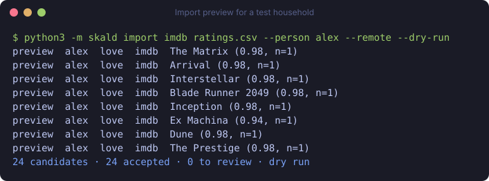

# Skald

<p align="center">
  <a href="https://github.com/Sophanos/skald/releases"></a>
  <a href="LICENSE"></a>
  <a href="https://github.com/Sophanos/skald/actions/workflows/ci.yml"></a>
</p>

**One recommendation engine for your whole household.** Skald merges watch history, ratings and imports per person. One to six members get personal rows, with Together rows for shared evenings and a “Who's watching?” control to attribute shared viewing. Optional AI curates picks and understands search requests using your recorded history. Skald runs in one container on your own machine and serves rows and search in Stremio, Odin on Apple TV and Mac, and Jellyfin apps through AIOStreams. Your existing stream addons handle playback. [Start with Quickstart](#quickstart).


## Why Skald?

- **One home for different tastes.** Personal rows for each member, shared picks for Together.
- **Use what you already know.** Connect Stremio, Trakt, MDBList, Jellyfin, Plex or AIOStreams. Import exports from other services.
- **AI that curates.** OpenRouter can choose AI picks and This Week picks, help choose mood shelves, and sort unclear import matches. Rows work without it.
- **Keep the household data at home.** You choose the connectors and AI. [Privacy](#privacy) lists what leaves the machine.

## Features

### Home


- Each member has four wish shelf slots by default; Together has two. Search `every sunday morning a classic for us`, `weekday evenings something light for me` or `make me a row of heist films`. Use `for MEMBER` for a named person. Confirm with `yes NN`; full shelves ask you to stop one first. `stop Classics` or `stop the sunday shelf` previews stopping an existing shelf; unmatched names stay title searches; `undo` restores it. `show 6 shelves` or `fewer shelves` changes slots (0..10). After shelf changes Skald asks AIOStreams to reload row names for logins made by `skald setup aiostreams`; Stremio installed with Skald's own link may need the link reinstalled to show new names. Schedules use the household timezone. Command cards appear once, in movie search results. Children manage only their own shelves, with their age filter.
- `More from <maker>` finds unseen work by directors and creators you like.
- Continue Watching & New Episodes and Catch Up help you return to your shows and film collections; two Anime rows cover airing and upcoming anime.
- Each member and the household get a short taste archetype, such as “Twisty puzzle chaser”, shown in `skald me` and `skald explain`. It describes taste and does not change picks.
- Each member can choose discovery style, release years and unwanted genres. Cards can show a short reason; the explanation API exposes a match score when there is enough history.
### Search


| You type | Skald does |
|---|---|
| “Dune” | Plain TMDB title search, without AI. |
| “cozy mystery for a rainy evening” | AI picks ordered by the request, blended with your household's taste match. |
| “anime I haven't watched” | Drops titles already in your recorded history from AI results. |
| “sci-fi I've watched” | Selects matching titles from your own recorded history. |
| “hide anime for Ana” | Previews a setting change. The “yes NN” code comes first in the card name. Open the card for details; type the code to apply, “undo” to revert. |
| “hide anime and show 6 shelves”; “no, I meant Ben” | Several changes preview as one plan with one code and one undo. A correction right after a change fixes it; unclear requests get one short question. |
| “not tonight Arrival”; “I already watched Arrival”; “Arrival is not for me, too slow” | Hides one title until tomorrow or a date, marks it seen, or rates it down with a reason. `undo` reverts each. |
| “Ben watched Arrival, not me”; “why is Arrival in my picks”; “something like Arrival” | Moves a watch to the right person, explains a pick, or finds similar titles without changing settings. |
| “help”; “ideas”, “suggest” | Help shows five search examples. Ideas offers at most two shelf suggestions; `yes NN` creates one, `no NN` dismisses it. |
| “what do you know about me”, “my settings” | Shows settings, personal and Together shelves, taste facets and recent commands. |
AI search needs OpenRouter; title search works without it. Commands work in English, German and Serbian. For explicit watched or not-watched requests, member links use that member's history and Together links use current members' combined history; ordinary AI search uses household history and taste. Watched searches use up to 300 recent titles with watch or rating evidence and omit disliked titles. If AI fails, search falls back to TMDB title results.

## How it works

1. Connect accounts or import exports, mapped to household members. Skald merges their signals into taste profiles.
2. Skald builds rows from history, TMDB recommendations and metadata, and AniList anime schedules. Optional OpenRouter adds curation.
3. Install the printed member or Together link in your watching setup. Use your stream addons to play.

## What changes as you watch

| What happens | What Skald changes | How soon |
|---|---|---|
| History or ratings change | Rows are ordered by taste; cards can show a short reason. | Next build; daily or on taste change, episodes every 3h, upcoming every 6h. |
| Taste changes with OpenRouter enabled | For You and the AI rewatch row refresh from your taste; This Week picks stay for the week. | At least 1h between taste-only builds, or twice daily. |
| A title is shown without a play | It moves down tracked rows except Continue Watching, Upcoming and Catch Up; For You impressions can remove it from the AI pick pool. | After six days shown in the relevant row. |
| You play picks from a theme shelf | Theme selection favours shelves that lead to plays; current slots get a staying bonus. | Daily or on taste change; bonus lasts 7 days without plays, 14 with plays. |
| A new evening starts | OpenRouter can choose moods from weekday, season and recent watching, with a penalty for yesterday's moods. | Once per logical day, starting at 05:00; rule rotation is the fallback. |
| A mapped person watches, or you set Who's watching? | Plays credit the mapped person, otherwise the active session; Together ranking uses adult members. | When history is read; without a session, unmapped plays count as Together. |
| Learned memory goes without new evidence | Its influence fades; preferences explicitly told to Skald keep their strength. | Learned strength halves every 180 days. |
| You abandon or dislike titles | Negative signals lower taste fit; opening a title is only a hint. | On the next taste update and row build. |
| You change `skald setup prefs` | Discovery style, years and genre exclusions shape rows; child age limits also filter search. | Next row request; apps may cache briefly. |
| Two positive titles share a director or creator | A `More from` shelf can show their unseen work if enough suitable titles remain. | Next theme build; needs at least eight unseen candidates. |

AI picks and AI mood selection need OpenRouter; other changes above work without it, though some shelves use saved AI tags. Rows with too few suitable titles stay hidden from the app.

## Rows

Rows appear when they have enough suitable titles. Names follow your household and the current picks. Experience shelves need saved title tags; OpenRouter creates these tags. Without a key, ordinary rows still build.

| Row title | What it brings | Needs OpenRouter? |
|---|---|---|
| Continue Watching & New Episodes | Next episodes from shows you watch. | No |
| ✨ For You | AI picks from a pool based on your taste. | Yes |
| `✨ This Week for <members>` | Weekly picks for each member and Together. | Yes |
| `For <member>` | Recommendations based on that person's positive history. | No curation call; uses saved experience tags |
| Coming Soon for You | Upcoming films and shows. | No |
| Family Picks (only when a child is set up) | Titles safe for every child, ordered by adult taste. | No |
| Catch Up | Shows and film collections you can return to. | No |
| Watch Again | Favourites and familiar titles to revisit. | No |
| `Because You Love <title>` | Similar picks from a rotating favourite; also “Like”, “Watched” or “Watch”. | No |
| `Same Feeling as <title>` | Similar experiences from a different world. | No curation call; uses saved experience tags |
| `More from <maker>` | Unseen work by a director or creator you like. | No |
| Picked for You | Fallback name for shelves built around your themes; names change with the theme. | No |
| Cozy Case Night, Big Ideas Night and other mood shelves | Four shelves chosen for the evening. | Uses saved tags; AI mood selection is optional |
| Top 10 Movies This Week / Top 10 Series This Week | Weekly trending titles. | No |
| Wonder of Our World / Mind & Cosmos / Great Lives & Empires / Big Questions | Documentary shelves. | No; AI can add weekly picks |
| HBO for You / Paramount+ for You | Studio and network shelves ranked by taste. | No |
| Anime · New This Week | Airing anime. | No |
| `Anime · Next Season (<season> <year>)` | Next season's anime. | No |
| New to You (opt-in) | Daily picks for one member or Together that keep a loved kind of story and add one they have not tried. Turn on with `skald setup rows` or “add the New to You row”. | Uses saved experience tags |
| Find your taste | Starter titles to rate on the private taste page. | No |

“More Like Your Favourites”, “Same Feeling, New World” and “Tonight's Mood” are fallback names while shelves build. “Picked for you” is also the member API's row label.

## Sources

Run connector commands on the server. Prefix them with `docker compose -f compose.stack.example.yaml exec skald` for the stack, or `docker compose exec engine` for Stremio direct. Run imports on a linked laptop with Python 3.12. Replace `NAME` with a configured member and filenames with your exports. Commands below preview imports without saving. After changing connectors, restart Skald now (`docker compose restart engine`, or `docker compose -f compose.stack.example.yaml restart skald` for the stack) so it starts reading.

| Source | What it supplies | Connect or preview command |
|---|---|---|
| Stremio library | Watched titles, library interests, loves and likes. | `skald setup --connect stremio --person NAME` |
| Trakt | Watch history and ratings; export at [Trakt Settings → Data](https://app.trakt.tv/settings/data) with "Export now". | `skald setup --connect trakt --person NAME`; export: `python3 -m skald import trakt trakt-export.zip --person NAME --remote --dry-run` |
| MDBList | Watched titles and watchlist interests. | `skald setup --connect mdblist --person NAME` |
| Jellyfin server | Watched titles, favourites and progress; setup maps users. | `skald setup --connect jellyfin --source-url http://jellyfin:8096` |
| Plex | Watched titles and progress for the token's account. | `skald setup --connect plex --source-url http://plex:32400 --person NAME` |
| AIOStreams database | Watched state, progress, favourites and ratings from Odin and other Jellyfin apps. | `skald setup --connect aiostreams-db --source-path /aio-data/db.sqlite` |
| Netflix | [Viewing activity](https://help.netflix.com/en/node/101917) ("Download all"); profile mapping for shared exports. | `python3 -m skald import netflix ViewingActivity.csv --person NAME --remote --dry-run` |
| IMDb | Ratings or watchlist CSV. | `python3 -m skald import imdb ratings.csv --person NAME --remote --dry-run` |
| Letterboxd | Ratings, diary, watched, likes and watchlist export. | `python3 -m skald import letterboxd export-folder --person NAME --remote --dry-run` |
| YouTube | Takeout watch history, JSON or HTML. | `python3 -m skald import youtube watch-history.json --person NAME --remote --dry-run` |
| Chrome | Title interests from allowed sites in a history database copy. | `python3 -m skald import chrome History --person NAME --remote --dry-run` |
| Plain text | One title per line. | `python3 -m skald import plain titles.txt --person NAME --remote --dry-run` |

Stremio viewing reaches Skald directly. AIOStreams records Jellyfin-app viewing, not Stremio playback. Trakt remains optional; its API app may need VIP, but JSON imports need no API app. Mount the AIOStreams database directory read-only before connecting it. Netflix exports with named profiles need `--profile-map "PROFILE=NAME"` for each profile. See [source limits and credentials](docs/CONNECTORS.md). A new household's first row build takes several minutes; rows fill in as they are built, and later builds reuse the cache.

## Personal settings

Run on the server with the same prefix as connector commands:

```sh
skald setup prefs --person NAME --discovery gems --years 1990- --hide documentaries,anime --focus-movie-genres horror,drama --focus-languages es --focus-countries ES
skald setup prefs --person NAME --clear
```

Choose `balanced` (default), `mainstream` (popular titles), or `gems` (high ratings with lower popularity). Years accept `1990-2010`, `1990-` or `--years=-2010`. Use `--hide` to add movies, series, documentaries, animation or anime; `--show anime` removes a hide. Animation hides all cartoons; anime hides Japanese animation. Focus genres, languages and countries rank personal rows without filtering; genre names are TMDB's English names.
Changes apply on the next row request; apps may cache rows briefly. Started titles in New Episodes skip hides, genre exclusions and years. Together respects genre and category hides except movies/series, and keeps its years and order. Set `skald setup prefs --person mia --kids-age 8` (ages 3..17; `--kids-age off` clears). Child age limits filter all Skald rows and search using household-country ratings, then US ratings. Other addons and streams are not filtered; also use the app's profile lock. TMDB ratings can be missing (titles are hidden) or wrong. [All settings](docs/SETUP.md#2-add-your-household).

## Screenshots

The pictures above show a test household in Odin: the row overview, Home and Search. Row names and picks change with the household's history. The import preview below also uses a test household.

## Install

### Pick your setup

Copy a ready-to-run [Compose setup](examples/README.md) for LAN apps, existing AIOStreams, HTTPS, a tunnel or a small box.

| You watch in | Install with | Learn from |
|---|---|---|
| Odin on Apple TV or Mac / Jellyfin apps | AIOStreams Jellyfin mode; `skald setup aiostreams`. | AIOStreams database, accounts and imports. |
| Stremio via AIOStreams | Stremio link from `skald setup aiostreams`. | Direct Stremio library, other accounts and imports. |
| Stremio with Skald's link | Printed member or Together addon link. | Direct Stremio library, other accounts and imports. |

The Odin on Apple TV and self-hosted Stremio via AIOStreams paths are tested by us. Stremio-direct playback setup, Plex and the standalone Jellyfin connector have not been tested by us with live services. The Stremio library connector has synthetic tests. See [watching](docs/WATCH.md).

## Quickstart

Use Docker and Docker Compose on your data machine. Get a free [TMDB API key](https://www.themoviedb.org/settings/api).

```sh
git clone https://github.com/Sophanos/skald skald && cd skald
mkdir -p data && sudo chown 65534 data && sudo chmod 700 data
cp .env.example .env && cp .env.aiostreams.example .env.aiostreams && chmod 600 .env .env.aiostreams
${EDITOR:-vi} .env .env.aiostreams
```

Put `TMDB_API=YOUR_KEY` and optional `OPENROUTER_API_KEY=YOUR_KEY` in `.env`. Delete the `SKALD_MEMBERS`, `SKALD_LANG` and `SKALD_TZ` lines from `.env`.
Setup asks for names, language and timezone. Skald runs as user 65534 and keeps DATA private. Make the AIOStreams secret with `openssl rand -hex 32`; set it and the public HTTPS address in `.env.aiostreams`.

```sh
docker compose -f compose.stack.example.yaml up -d --build
docker compose -f compose.stack.example.yaml exec skald skald setup
docker compose -f compose.stack.example.yaml exec skald skald setup aiostreams
```

The empty Skald container waits for setup. Setup makes your AIOStreams login with Skald and TMDB title details. Add the printed server in Odin and use the printed user and password, or install the printed Stremio link. Configure your stream addons in AIOStreams, then connect your taste sources above.
[AIOStreams](https://github.com/Viren070/AIOStreams) is a separate project with its own docs and licence. We use its published image.

Stremio only, without AIOStreams: copy only `.env`, edit it as above, then run `docker compose up -d --build`.
Run `docker compose exec engine skald setup --watch stremio` and install the printed link.

### Teach it your taste

Imports run on a laptop with Python 3.12 and a clone of this repo. First [make the laptop API reachable](docs/SETUP.md#6-link-a-laptop-optional).



1. On the server: `docker compose -f compose.stack.example.yaml exec skald skald setup link --name laptop`. This token covers every member. Adding `--person alex` limits it to Alex; other members' titles are skipped when pushing.
2. On the laptop: `python3 -m skald connect http://127.0.0.1:8081 --token-stdin`. Use your own API address and paste the token.
3. Preview: `python3 -m skald import imdb ratings.csv --person NAME --remote --dry-run`. Your server resolves titles; the laptop needs no TMDB key. To save, repeat without `--dry-run` and with `--yes`. Without server lookups, use `--resolve-online` with `TMDB_API` on the laptop.
4. `python3 -m skald push imports --remote` previews the send. Add `--apply` to send.

Imports and connector data enter rows on their next scheduled build. Clicks and opened title pages do not teach taste.

## Configuration

- Required: `TMDB_API` in the private `.env` file. Optional: `OPENROUTER_API_KEY` for AI.
- Setup saves members, language, timezone, country and connector mappings in `DATA/skald.json`. Credentials use private files and prompts.
- Check progress with `docker compose -f compose.stack.example.yaml exec skald skald setup --status`. Restart after connector changes.
- Outside your home network, give AIOStreams an HTTPS address through a proxy or tunnel. Skald stays inside Docker for watching through AIOStreams. Stremio direct and laptop imports need their own reachable Skald address.

See [setup and network configuration](docs/SETUP.md) for the full instructions.

## Privacy

Household history and taste are stored on your machine. These requests leave it:

| Destination | What it receives |
|---|---|
| TMDB | Title and ID lookups, recommendations and metadata requests. Watching apps also load TMDB artwork. |
| OpenRouter, if enabled | Taste and history context, title metadata and overviews for embeddings and tagging, search requests and unclear import candidates. |
| AniList | Anime queries and titles, possibly from your history. |
| NZBHydra, if configured | Titles for availability checks. |
| Connectors you enable | Account or server history requests and authentication. The AIOStreams database connector reads a local file. |

Raw exports stay on the laptop. Remote previews send title candidates to your Skald server; pushing sends resolved signals. Keep addon links, tokens, data and backups private. Anyone with the household addon link can choose any member's rows.

## Docs

[Setup](docs/SETUP.md) · [Watching](docs/WATCH.md) · [Connectors](docs/CONNECTORS.md) · [Backups and upgrades](docs/UPGRADE.md) · [Commands](docs/CLI.md)

## License

[GNU AGPL-3.0](LICENSE). This product uses TMDB and the TMDB APIs but is not endorsed, certified, or otherwise approved by TMDB.
